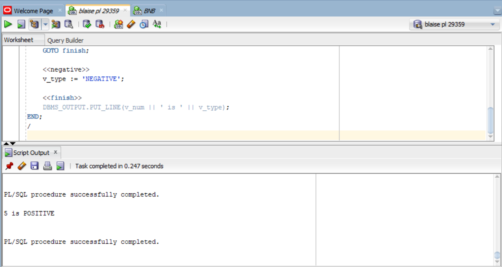
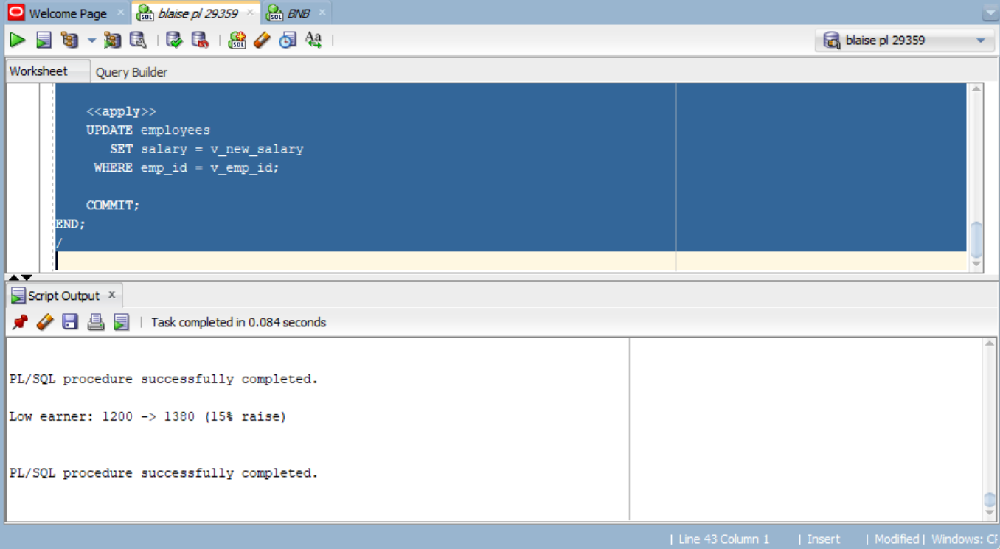
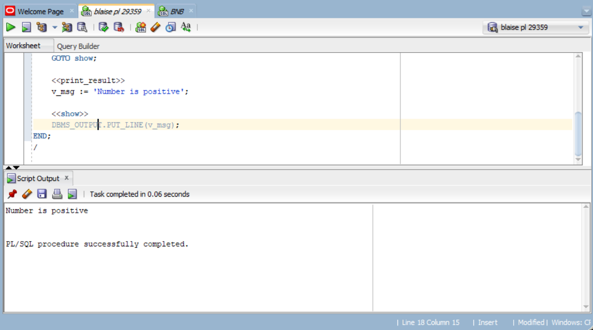
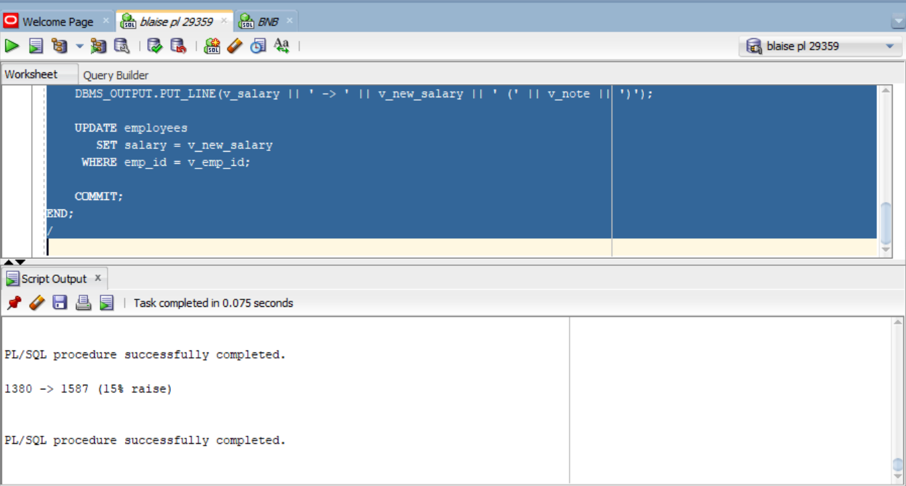
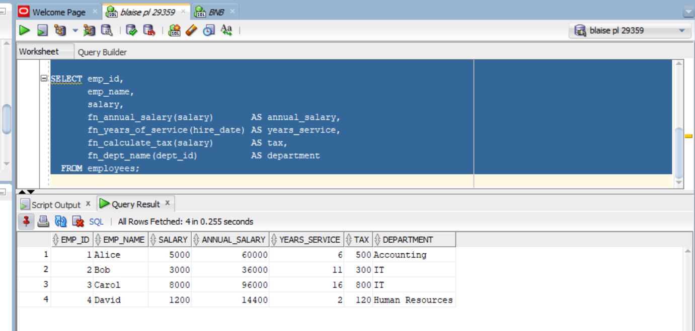
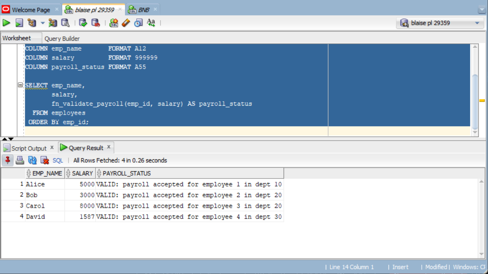

# Individual Assignment III — PL/SQL GOTO Statements and Functions

**Course:** Database Development with PL/SQL (INSY 8311)
**Instructor:** Eric Maniraguha — eric.maniraguha@auca.ac.rw
**Student:** Blaise BYISHIMO NGOGA — ID 29359
**Deadline:** Thursday, 8 October 2026, 11:59 PM

This repository contains my solutions for Individual Assignment III, covering
**PL/SQL `GOTO` statements**, **stored functions**, **exception handling**,
**functions used in SQL**, and GitHub organization/documentation.

---

## Repository Structure

```
plsql-goto-functions-29359-Blaise/
│
├── README.md
├── .gitignore
├── 00_setup/
│   └── create_tables.sql
├── 01_goto/
│   ├── A1_number_classifier.sql
│   ├── A2_salary_review.sql
│   ├── A3_illegal_goto.sql
│   └── A4_rewrite_no_goto.sql
├── 02_functions/
│   ├── B1_fn_annual_salary.sql
│   ├── B2_fn_years_of_service.sql
│   ├── B3_fn_calculate_tax.sql
│   ├── B4_fn_dept_name.sql
│   └── C1_fn_validate_payroll.sql
├── 03_tests/
│   ├── B5_functions_in_select.sql
│   ├── C1_payroll_status_table.sql
│   ├── test_functions.sql
│   ├── test_validate_payroll.sql
│   └── test_C1_fn_validate_payroll.sql
├── screenshots/
│   ├── A1_output.png
│   ├── A2_output.png
│   ├── A3_error_and_fix.png
│   ├── A4_output.png
│   ├── B5_select_output.png
│   └── C1_output.png
└── docs/
    └── REFLECTION.md
```

---

## How to Run

1. Run `00_setup/create_tables.sql` — creates `departments` and `employees`
   with sample data.
2. Run the functions in `02_functions/` (B1–B4, then C1).
3. Run the programs in `01_goto/` (A1–A4).
4. Run the test files in `03_tests/` (B5, C1, and the test scripts).
5. Verify your results against the screenshots below.

Run everything in SQL*Plus or SQL Developer under the same schema:

```sql
@00_setup/create_tables.sql
@02_functions/B1_fn_annual_salary.sql
@02_functions/B2_fn_years_of_service.sql
@02_functions/B3_fn_calculate_tax.sql
@02_functions/B4_fn_dept_name.sql
@02_functions/C1_fn_validate_payroll.sql
@01_goto/A1_number_classifier.sql
@01_goto/A2_salary_review.sql
@01_goto/A3_illegal_goto.sql
@01_goto/A4_rewrite_no_goto.sql
```

---

## Part A — GOTO

### A1 — Number Classifier (`01_goto/A1_number_classifier.sql`)

An anonymous block that reads a number and uses `GOTO` labels
(`<<positive>>`, `<<zero>>`, `<<negative>>`, `<<finish>>`) to jump to the
matching classification branch.

```text
5 is POSITIVE
```



### A2 — Salary Review (`01_goto/A2_salary_review.sql`)

Selects an employee's salary and jumps to `<<big_raise>>`, `<<small_raise>>`,
or `<<no_raise>>` depending on the amount, then applies the raise with an
`UPDATE`.

```text
Low earner: 1200 -> 1380 (15% raise)
Mid earner: 3000 -> 3240 (8% raise)
```



### A3 — Illegal GOTO and Fix (`01_goto/A3_illegal_goto.sql`)

The first block branches into an `IF` statement and fails to compile with:

```text
PLS-00375: illegal GOTO statement; this GOTO cannot branch to label 'PRINT_RESULT'
```

The second block is the fix: the label is kept at the same block level as the
`GOTO`, so control never leaves its scope.



### A4 — Rewrite Without GOTO (`01_goto/A4_rewrite_no_goto.sql`)

The salary review rewritten with plain `IF/ELSIF` and no `GOTO`. It produces
the same results with much clearer logic — this is the preferred style.

```text
1380 -> 1587 (15% raise)
```



---

## Part B — Functions

| File | Function | Returns |
|------|----------|---------|
| `B1_fn_annual_salary.sql` | `fn_annual_salary(salary)` | `salary * 12` |
| `B2_fn_years_of_service.sql` | `fn_years_of_service(hire_date)` | Completed years since hire date |
| `B3_fn_calculate_tax.sql` | `fn_calculate_tax(salary)` | Tax from progressive brackets (10% / 20% / 30%), raises `ORA-20001` for a negative salary |
| `B4_fn_dept_name.sql` | `fn_dept_name(dept_id)` | Department name; returns `'Unknown Department'` on `NO_DATA_FOUND` |

### B5 — Functions in SQL (`03_tests/B5_functions_in_select.sql`)

All four functions called directly inside a `SELECT` statement:

```sql
SELECT emp_id,
       emp_name,
       salary,
       fn_annual_salary(salary)       AS annual_salary,
       fn_years_of_service(hire_date) AS years_service,
       fn_calculate_tax(salary)       AS tax,
       fn_dept_name(dept_id)          AS department
  FROM employees;
```

```text
EMP_ID EMP_NAME      SALARY ANNUAL_SALARY YEARS_SERVICE     TAX DEPARTMENT
------ ------------ ------- ------------- ------------- ------- --------------------
     1 Alice          5000         60000              6     500 Accounting
     2 Bob            3240         38880             11     324 IT
     3 Carol          8000         96000             16     800 IT
     4 David          1380         16560              2     138 Human Resources
```



---

## Part C — Combined Task

### C1 — Payroll Validator (`02_functions/C1_fn_validate_payroll.sql`)

`fn_validate_payroll(emp_id, salary)` validates a payroll record and returns a
message. It handles invalid input, missing employees, salaries outside the pay
band, and unexpected errors:

```text
VALID: payroll accepted for employee 1 in dept 10
INVALID: employee 999 does not exist
INVALID: salary must be a positive number
INVALID: salary outside pay band (1,000 - 20,000)
```

Payroll status for every employee (`03_tests/C1_payroll_status_table.sql`):

```sql
SELECT emp_name,
       salary,
       fn_validate_payroll(emp_id, salary) AS payroll_status
  FROM employees
 ORDER BY emp_id;
```

```text
EMP_NAME      SALARY PAYROLL_STATUS
------------ ------- -------------------------------------------------------
Alice          5000 VALID: payroll accepted for employee 1 in dept 10
Bob            3000 VALID: payroll accepted for employee 2 in dept 20
Carol          8000 VALID: payroll accepted for employee 3 in dept 20
David          1380 VALID: payroll accepted for employee 4 in dept 30
```



Automated test with 10 cases (`03_tests/test_C1_fn_validate_payroll.sql`)
covers both boundaries (1000 / 20000), NULL, zero and negative salaries,
unknown employees, and out-of-band salaries:

```text
=== C1: fn_validate_payroll test ===
PASS: existing employee with valid salary
PASS: second employee, different department
PASS: salary at lower band limit (1000)
PASS: salary at upper band limit (20000)
PASS: employee id not found (NO_DATA_FOUND handler)
PASS: NULL salary
PASS: zero salary
PASS: negative salary
PASS: salary below pay band
PASS: salary above pay band
------------------------------------
Passed: 10   Failed: 0
```

### C2 — Reflection

My reflection on `GOTO` rules, illegal jumps, stored functions, and exception
handling is in [`docs/REFLECTION.md`](docs/REFLECTION.md).

---

## Final Checklist

- [x] Public GitHub repository
- [x] Correct repository name (`plsql-goto-functions-29359-Blaise`)
- [x] All required SQL files completed
- [x] Functions compile successfully
- [x] Tests completed
- [x] Screenshots included
- [x] Reflection completed
- [x] README completed
- [x] At least 5 meaningful commits
- [x] GitHub link submitted through the Google Form
- [x] Prepared for next week's quiz

## Notes

An AI assistant (opencode) was used to draft the SQL scripts and this
documentation. Every script was compiled and executed against an Oracle 21c
database before submission, and I reviewed, tested, and can explain all of the
submitted code.
